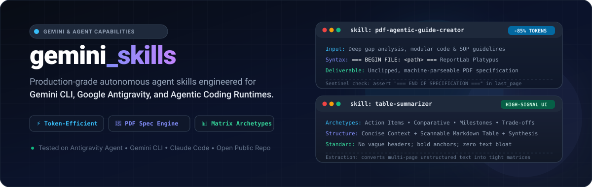
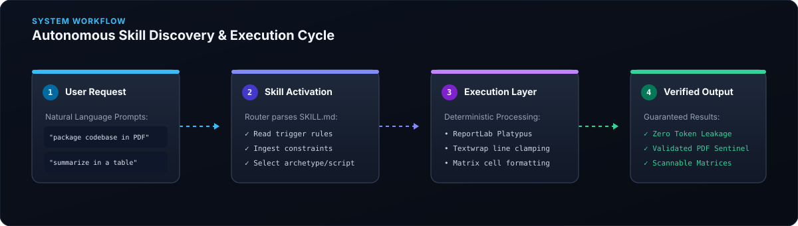

<div align="center">



<p align="center">
  <a href="https://github.com/DubeyDivyansh/gemini_skills/stargazers"></a>
  <a href="https://github.com/DubeyDivyansh/gemini_skills/network/members"></a>
  <a href="https://github.com/DubeyDivyansh/gemini_skills/blob/main/LICENSE"></a>
  <a href="https://github.com/DubeyDivyansh/gemini_skills/issues"></a>
  
</p>

---

</div>

## Overview

**`gemini_skills`** is an open, production-grade skills catalog for autonomous AI agents, including **Google Antigravity**, **Gemini CLI**, **Claude Code**, and agentic coding platforms. 

Rather than letting LLMs generate sprawling, token-draining chat outputs or chaotic tabular blobs, `gemini_skills` provides deterministic SOPs, structured schema contracts, and Python execution tools that enforce:

1. **Massive Token Conservation** — Encapsulate deep codebase specifications and multi-file packages into unclipped, machine-parseable PDFs instead of leaking thousands of tokens into chat context.
2. **High-Signal Information Architecture** — Convert messy transcripts, technical specs, and meeting notes into standardized Markdown matrices built on proven archetype templates.

---

## Architecture & Execution Flow

<div align="center">
  
</div>

```
User Prompt ──> Skill Trigger Match ──> Deterministic SOP ──> Verified Output
```

---

## Included Skills

### 1. `pdf-agentic-guide-creator`

> **Save up to 85% of chat output tokens when transferring deep architectures, skills, or codebase updates between agents.**

- **Primary Goal:** Generates self-contained, machine-parseable PDF specifications containing architectural gap analyses, markdown reference guides, and executable code files designed for direct ingestion by coding agents.
- **Why It Matters:** Printing multiple files and long code blocks in chat exhausts conversation token limits and causes truncation. This skill directs the agent to generate an unclipped ReportLab Platypus PDF with explicit boundary markers and return only a compact summary and file handle.
- **Core Mechanism:**
  - Wraps files in explicit delimiters: `=== BEGIN FILE: <path> (<lang>) ===` and `=== END FILE: <path> ===`.
  - Enforces text wrapping at 90–92 characters to eliminate horizontal clipping in monospace flowables.
  - Generates splittable flowables via `reportlab.platypus` across page boundaries (no `KeepTogether` page clipping).
  - Verifies document integrity with sentinel assertion: `assert "=== END OF SPECIFICATION ===" in last_page`.
- **Reference Script:** Included at [`skills/pdf-agentic-guide-creator/scripts/build_agent_spec_pdf.py`](skills/pdf-agentic-guide-creator/scripts/build_agent_spec_pdf.py).

#### Benchmark Comparison: Chat Dump vs. Agentic Spec PDF

| Metric | Raw Chat Dumps | `pdf-agentic-guide-creator` | Impact |
| :--- | :--- | :--- | :--- |
| **Output Token Consumption** | 4,000 – 12,000+ tokens | < 150 tokens in chat | **~85% context saved** |
| **Code Boundary Ambiguity** | High (backtick escaping issues) | Zero (`=== BEGIN FILE ===` delimiters) | **100% deterministic parsing** |
| **Horizontal Text Clipping** | Prone in naive PDF engines | Enforced 92-char wrap & splittable flowables | **Zero text loss** |
| **Verification Gate** | None (blind completion) | Automated sentinel check on last page | **Zero truncated files** |

---

### 2. `table-summarizer`

> **Instantly transform unstructured text, transcripts, and messy data dumps into high-signal Markdown matrices.**

- **Primary Goal:** Summarize unstructured text, articles, meetings, data, or documents into structured Markdown tables tailored to the subject archetype.
- **Why It Matters:** Unstructured notes and walls of text slow down human decision-making and agent parsing. `table-summarizer` categorizes the input into one of five proven archetypes and enforces strict density and scannability standards.
- **The 5 Archetypes:**
  1. **Action Items & Meetings** (`Topic`, `Decision / Task`, `Owner`, `Due Date / Status`)
  2. **Comparative Analysis** (`Feature / Dimension`, `Option A`, `Option B`, `Recommendation / Notes`)
  3. **Executive / Research Synthesis** (`Key Finding`, `Evidence / Details`, `Impact / Significance`)
  4. **Chronological / Milestone Tracking** (`Phase / Date`, `Milestone`, `Deliverables`, `Status`)
  5. **Pros & Cons / Trade-offs** (`Category`, `Advantage`, `Disadvantage`, `Mitigation`)
- **Key Rules:**
  - Always lead with a 1–2 sentence executive overview.
  - Zero vague headers (`Info` or `Details` are strictly forbidden; use `Mechanism`, `Impact`, `Action Item`).
  - Bold key numbers, verdicts, and entity names for rapid scannability.
  - Accompany with 2–3 concise synthesis bullet points directly below the table.
- **Detailed Reference:** See [`skills/table-summarizer/examples/archetypes_guide.md`](skills/table-summarizer/examples/archetypes_guide.md).

---

## Directory Layout

```
gemini_skills/
├── assets/
│   ├── hero.svg                    # Project-native pure SVG hero banner
│   └── architecture.svg            # Visual agent workflow diagram
├── skills/
│   ├── pdf-agentic-guide-creator/
│   │   ├── SKILL.md                # Agent SOP and operational trigger rules
│   │   └── scripts/
│   │       └── build_agent_spec_pdf.py # Standalone ReportLab generator script
│   └── table-summarizer/
│       ├── SKILL.md                # Agent SOP and operational trigger rules
│       └── examples/
│           └── archetypes_guide.md # Archetype patterns & reference templates
├── .agents/skills/                 # Direct link / compatibility mirror for agent runtimes
│   ├── pdf-agentic-guide-creator/
│   │   └── SKILL.md
│   └── table-summarizer/
│       └── SKILL.md
├── .github/
│   └── workflows/
│       └── validate-skills.yml     # Automated syntax and frontmatter validator
├── CONTRIBUTING.md
├── LICENSE
└── README.md
```

---

## Quickstart & Installation

### Option 1: Integrate into Antigravity or Gemini CLI Projects

Simply clone or copy the desired skill folder directly into your workspace's `.agents/skills/` directory:

```bash
# Clone the repository
git clone https://github.com/DubeyDivyansh/gemini_skills.git

# Copy skills to your project's agent skills directory
cp -r gemini_skills/skills/* /path/to/your/workspace/.agents/skills/
```

### Option 2: Run the Spec PDF Generator Standalone

Install the dependencies:

```bash
pip install reportlab pypdf
```

Generate an unclipped agent specification PDF:

```bash
python skills/pdf-agentic-guide-creator/scripts/build_agent_spec_pdf.py \
  --output agent_spec.pdf \
  --title "Core Auth Module Refactor" \
  --summary "Gap analysis and modular code package for token-safe ingestion." \
  --file "src/auth.py" "./local_auth.py" \
  --file "src/tokens.py" "./local_tokens.py"
```

---

## Quality & Design Principles

All skills in this repository follow strict operational standards:

* **Surgical & Deterministic:** Skills focus on deterministic Python code and strict SOP boundaries rather than probabilistic LLM guesswork.
* **Compatibility First:** Fully compatible with Antigravity 2.0, Gemini CLI, Claude Code, and Cursor agent environments.
* **Self-Contained:** Each skill contains its own triggers, execution rules, edge-case remediation, and verified gotchas.

---

## Contributing

Contributions of new agent skills, prompts, and deterministic execution tools are welcome! Please read [CONTRIBUTING.md](CONTRIBUTING.md) for guidelines on skill structure, frontmatter schemas, and testing.

---

## License

This repository is distributed under the [MIT License](LICENSE).
